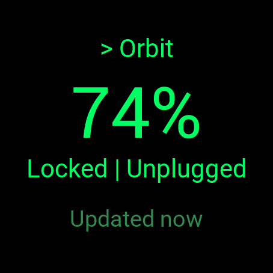

# Orbit for Lucid

Control the core functions of a Lucid vehicle (status/SOC, lock, unlock, precondition) from a Garmin watch, through an
Android companion app.

> **Unofficial.** Not affiliated with, endorsed by, or sponsored by Lucid Motors or Garmin. It uses an
> undocumented, reverse-engineered API that may change or be withdrawn at any time, and using it may conflict with
> Lucid's terms. Use at your own risk, on your own account.

## Status

Working end to end on the author's setup: a Pixel 10 Pro, a Garmin Venu 3, and one Lucid. From the watch you can see
state of charge, locked/unlocked and plugged/charging, then lock, unlock, start or stop climate at a temperature you
pick (in the watch's own units), and refresh. Unlock and climate changes ask for a confirm tap; lock does not. Commands wake a sleeping car first. See [PLAN.md](PLAN.md) for the roadmap.

**Timings are anecdotes.** In one round of tests on one car, an unlock from a sleeping car took about 13 seconds
without car wifi and 9-10 seconds with it, and a lock on an awake car took a second or two. That is a single set of
tests against a single vehicle, and Lucid's cloud is known to vary wildly: expect results that are much faster or much
slower, and don't read the difference between those two runs as meaningful.

## Screenshots

<p>
  
  
</p>

Left: the watch app on a Venu 3. Right: the phone app. The car's nickname is blurred out in the phone screenshot.

## Limitations

- **One vehicle only.** The author owns a single Lucid (a US vehicle) and has not tried an account with more than one.
  The app uses the first vehicle the account returns and has no way to pick another. Multi-vehicle accounts are
  untested and probably don't work properly; reports and patches are welcome.
- **Lucid's terms.** Orbit has you type your Lucid credentials into software that isn't Lucid's. Section 3 of Lucid's
  Connectivity Services Terms and Conditions tells you not to do anything that might jeopardize the security of your
  password or account, and section 12.3 lets Lucid suspend or cancel accounts at its discretion. Lucid's other terms
  (app and website) may say more; the author has not read them. Whether this is allowed is your call, and any
  consequences for your account are yours.
- **Tested on the Venu 3 only.** The Venu 3 is the only watch it has run on. The manifest also lists the Venu X1
  and the fenix 7, which build without errors but have never been run, not even in a simulator (the Connect IQ
  simulator crashes in the author's setup). Screen layout, button handling and memory use on them are unknown. The
  Venu X1 needs a Connect IQ SDK with API level 6.0.3 or newer. To try another watch, add its id to `manifest.xml`
  and build with `-d <id>`; if you do, please report what happens. The glance shows cached state only (no widget).
- **Tested on one phone.** Android only, tested on a Pixel 10 Pro. Needs Garmin Connect Mobile installed and paired
  with the watch.
- **Not in any app store.** You build both apps yourself and sideload them. See Building.
- **Limited commands.** No trunk/frunk, charge control, tire pressure, windows or location (some of that is on the
  roadmap).
- **A notification stays on the phone.** Android only lets the app answer the watch while the phone app is kept
  alive, so it runs a small foreground service with a permanent low-priority notification ("Watch link active").
  On Android 13 and later the app asks for notification permission on first launch, only for this notification.
  If you decline, the notification is hidden but the watch link still works; it just gives you no sign that the
  service is running, and Android may be quicker to stop it. There is no on/off switch: log out in the app to stop
  the watch controlling the car, or stop the app from Android's active-apps list to end the service. The service
  restarts itself after a reboot, once you first unlock the phone. If you force-stop the app, Android won't start it
  again until you open it by hand, and until then the watch says "Phone not reachable".
- **Slow and sometimes laggy.** The car takes a while to wake and to report changes. The app polls for confirmation
  for about 105 seconds, then gives up with "no confirmation yet" (the command may still have worked).
- **Rate limits.** Lucid's gateway throttles frequent status calls. Polling is deliberately gentle, and you may still
  see a "rate" error if you hammer it.
- **Little testing of failure cases.** Offline, logged-out, a car on wifi, battery impact over days, and surviving
  reboots are not well tested yet.
- **The API is unofficial.** It can change or disappear without notice.

## How it works

```
Garmin watch app (Connect IQ, Monkey C)
   | Bluetooth via Garmin Connect Mobile
   v
Android companion app (Kotlin)  -- holds your Lucid session, encrypted on the phone
   | HTTPS
   v
Lucid cloud API (unofficial)
```

Your Lucid credentials never go anywhere except Lucid. There is no Orbit server.

## Layout

| Path | Contents |
|---|---|
| `android/` | Kotlin companion app (Lucid protos from python-lucidmotors, MIT, in `app/src/main/proto`) |
| `watch/` | Monkey C Connect IQ app |
| `docs/` | Protocol, security and research notes |

## Building and installing

Step-by-step instructions for building both apps and sideloading them (including other watch models) are in
[INSTALL.md](INSTALL.md). In short:

- **Garmin SDK:** the Connect IQ SDK is not included in this repo and must not be committed. Install it yourself with
  Garmin's SDK Manager and accept Garmin's license: https://developer.garmin.com/connect-iq/sdk/
- **Android:** the Connect IQ Mobile SDK is pulled from Maven Central by Gradle.
- Install the secret-scanning hook: `git config core.hooksPath .githooks` (requires
  [gitleaks](https://github.com/gitleaks/gitleaks)).

## Privacy

Orbit has no server, no accounts and no analytics. The author receives nothing from your use of it.

- **Lucid password:** typed once in the phone app and sent only to Lucid's login service. It is not stored.
- **Lucid session:** only a refresh token is kept, encrypted with a key held in the phone's Android Keystore. Android
  backup is disabled, so it is not copied to the cloud or to a new phone. Log out in the app to delete it.
- **Watch:** stores a cached copy of the last state (charge, lock state, charging, climate, and when it was fetched).
  No credentials or tokens are ever sent to the watch.
- **Watch to phone:** messages travel over Bluetooth through Garmin Connect Mobile, which is covered by Garmin's own
  privacy terms.
- **Car data:** the phone asks Lucid's cloud for your vehicle's state and sends commands to it. That traffic is between
  your phone and Lucid and is covered by Lucid's terms. Orbit does not log tokens, emails or VINs, and it does not
  request or use your phone's location or the car's.

## Security

See [SECURITY.md](SECURITY.md). Never commit credentials, tokens, VINs, signing keys or Garmin developer keys.

## A note from the author

I've been in IT a long time and I know my way around security concepts and keeping secrets secret. But my background
is system tool scripting (bash, a bit of Python) and automation (Ansible). I am not a programmer. This app was vibe
coded like a MoFo. I can follow a fair bit of it and I've tested it on my own car, but I couldn't tell you whether the
Kotlin or Monkey C is any good.

I took care with the stuff I do know (no secrets in the repo, no Orbit server, the watch never sees your credentials,
a secret-scanning hook), but that isn't the same as a real code review. If you use this, you're trusting AI-written
code with your car and your Lucid account. You're on your own until a real Android or Garmin developer looks it over
for mistakes. If that's you, please do, and tell me what I got wrong.

## License

MIT, see [LICENSE](LICENSE). Third-party attributions are in [NOTICE](NOTICE). The Garmin SDK is under Garmin's own
license and is not covered by this one.
