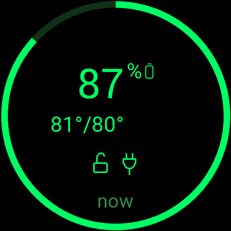
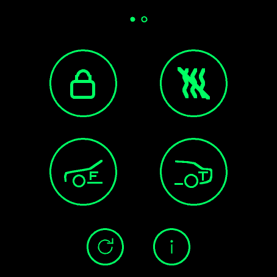
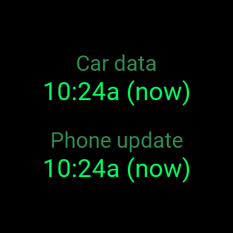
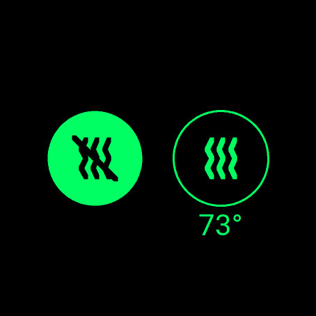
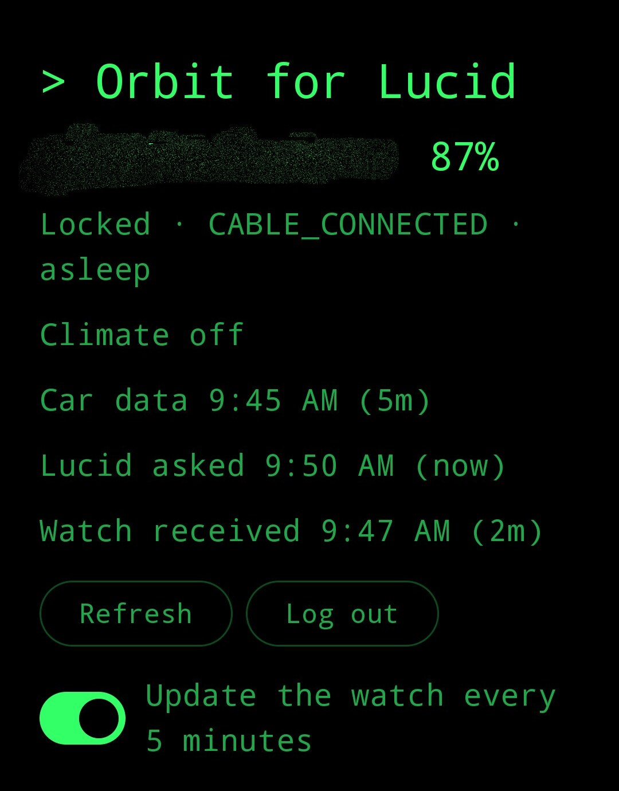

# Orbit for Lucid

Control the core functions of a Lucid vehicle (status/SOC, lock, unlock, precondition) from a Garmin watch, through an
Android companion app.

> **Unofficial.** Not affiliated with, endorsed by, or sponsored by Lucid Motors or Garmin. It uses an
> undocumented, reverse-engineered API that may change or be withdrawn at any time, and using it may conflict with
> Lucid's terms. Use at your own risk, on your own account.

## Status

Working end to end on the author's setup: a Pixel 10 Pro, a Garmin Venu 3, and one Lucid. From the watch you can see
state of charge, locked/unlocked, plugged/charging and the inside and outside temperature, then lock, unlock, start
or stop climate at a temperature you pick (in the watch's own units), and refresh. Unlock and climate changes ask for a confirm tap; lock does not.
Commands wake a sleeping car first. See [PLAN.md](PLAN.md) for the roadmap.

| Watch | Status |
|---|---|
| Venu 3 | Tested on a real watch |
| fenix 7 | Builds and runs in Garmin's simulator (layout and buttons checked); never on a real watch |
| Venu X1 | Builds and runs in Garmin's simulator (layout and touch checked); never on a real watch |

The fenix 7 and Venu X1 are tentative: treat them as untested until someone runs them on hardware.

## Using the watch app

- **Glance.** The charge in percent with a small battery icon, then a closed or open padlock for locked or unlocked,
  then a plug icon: a plug with a slash when unplugged, a plain plug when plugged in but not charging, and a bolt while
  charging. The percent and battery icon take the main screen's charge colours. It shows what the phone last pushed,
  with no age.
- **Main screen**, from the top down:
  - **Charge.** A ring round the edge fills clockwise from the top to match the charge, and the rest of the ring
    stays dark. The big number in the middle is the same charge in percent, with a small battery icon beside it. The
    ring, number and icon are green from 50%, yellow from 25%, orange from 10% and red below that.
  - **Temperatures.** Under the number, `21°/14°` is the cabin and the outside air temperature, in the watch's units
    (`--` for one the car did not report, nothing at all if it reported neither).
  - **State icons**, shown only when they apply: a closed or open padlock (locked or unlocked), a plug when plugged
    in, a bolt beside it while charging, and wavy lines while climate is on.
  - **Bottom line.** How old the car's data is (for example `2m`), or what is in progress ("Unlocking...") or an
    error. The car only reports while awake, so after 30 minutes the whole screen dims and the age turns amber; that is
    normal, not an error.
- **Stays current.** About every 5 minutes the phone fetches status and sends it to the watch, even while the
  app is closed, so the glance and the main screen open on recent data. It does this whether or not the watch is
  connected at that moment; a send to an absent watch just fails. Android can delay the timer while the phone
  sleeps. A switch in the phone app turns this off; turning it back on sends the last status at once, which is a
  quick way to refresh a watch that was out of range or plugged in. If Garmin Connect restarts, the phone reconnects
  to it by itself after about 30 seconds.
- **Actions.** Tap the screen (or press the select button) for big icons: lock, climate and refresh.
- **Info** is the small `i` button under them. It shows when the car last reported and when the phone last sent
  status to the watch, so you can tell whether the 5 minute updates are arriving, and the watch app's version at
  the bottom. The phone app shows the same times, plus when it last asked Lucid.
- **Lock** shows a closed or open padlock for the last state it saw, and opens a choice of lock or unlock that does
  not depend on that state. Unlock then asks you to confirm.
- **Climate** opens a choice of off or on. On shows the car's current set point and opens a scrolling list over the
  car's range (59-86 F, or 15-30 C, following the watch's unit setting), then asks you to confirm. Picking a new
  temperature while climate is already on changes it.
- **Back** is the watch's back button.

**Timings are anecdotes.** In one round of tests on one car, an unlock from a sleeping car took about 13 seconds
without car wifi and 9-10 seconds with it, and a lock on an awake car took a second or two. That is a single set of
tests against a single vehicle, and Lucid's cloud is known to vary wildly: expect results that are much faster or much
slower, and don't read the difference between those two runs as meaningful.

## Screenshots

<p>
  
  
  
  
  
  
</p>
<p>
  
</p>

Top: the watch app on a Venu 3 (glance, main screen, actions, info, lock or unlock, climate off or on). Bottom: the
phone app, which shows status and settings only; the car is controlled from the watch. The car's nickname is blurred
out in the phone screenshot.

## Limitations

- **One vehicle only.** The author owns a single Lucid (a US vehicle) and has not tried an account with more than one.
  The app uses the first vehicle the account returns and has no way to pick another. Multi-vehicle accounts are
  untested and probably don't work properly; reports and patches are welcome.
- **Lucid's terms.** Orbit has you type your Lucid credentials into software that isn't Lucid's. Section 3 of Lucid's
  Connectivity Services Terms and Conditions tells you not to do anything that might jeopardize the security of your
  password or account, and section 12.3 lets Lucid suspend or cancel accounts at its discretion. Lucid's other terms
  (app and website) may say more; the author has not read them. Whether this is allowed is your call, and any
  consequences for your account are yours.
- **Tested on the Venu 3 only.** The Venu 3 is the only watch it has run on. The manifest also lists the Venu X1
  and the fenix 7 (see the table under Status). Both build without errors and their screens (main, actions, info,
  climate, the set point list and the confirm) have been run in Garmin's simulator, but never on a real watch. The
  simulator draws Garmin's stock menus differently from real hardware, and memory use and the glance on those
  watches are untested. The Venu X1 needs a Connect IQ SDK with API level 6.0.3 or newer. To try another watch, add its
  id to `manifest.xml` and build with `-d <id>`; if you do, please report what happens. The glance shows cached state
  only (no widget).
- **Tested on one phone.** Android only, tested on a Pixel 10 Pro. Needs Garmin Connect Mobile installed and paired
  with the watch.
- **Not in any app store.** You build both apps yourself and sideload them. See Building.
- **Limited commands.** No trunk/frunk, charge control, tire pressure, windows or location (some of that is on the
  roadmap).
- **Temperature units follow the watch.** The Fahrenheit list is the one that has been tried; the Celsius one
  (half-degree steps) has not. The car reads a set point back within about 0.4 F of what was sent, so the number it
  shows can differ from your pick by a rounding step.
- **A notification stays on the phone.** Android only lets the app answer the watch while the phone app is kept
  alive, so it runs a small foreground service with a permanent low-priority notification ("Watch link active").
  On Android 13 and later the app asks for notification permission on first launch, only for this notification.
  If you decline, the notification is hidden but the watch link still works; it just gives you no sign that the
  service is running, and Android may be quicker to stop it. There is no on/off switch: log out in the app to stop
  the watch controlling the car, or stop the app from Android's active-apps list to end the service. The service
  restarts itself after a reboot, once you first unlock the phone. If you force-stop the app, Android won't start it
  again until you open it by hand, and until then the watch says "No phone link".
- **Slow and sometimes laggy.** The car takes a while to wake and to report changes. The app polls for confirmation
  for about 105 seconds, then gives up with "no confirmation yet" (the command may still have worked).
- **Rate limits.** Lucid's gateway throttles frequent status calls. Polling is deliberately gentle, and you may still
  see a "rate" error if you hammer it.
- **Lucid sees a status request every 5 minutes.** Besides your taps, the phone asks Lucid for status on that timer
  (see "Stays current"), from your account, whether or not you are using the app. That is the kind of thing Lucid's
  terms (above) may not welcome; you can turn it off with the switch in the phone app. It does not wake the car.
- **Little testing of failure cases.** Offline, logged-out, a car on wifi, battery impact over days (including the
  5 minute updates), and surviving reboots are not well tested yet.
- **The API is unofficial.** It can change or disappear without notice.

## How it works

```
Garmin watch app (Connect IQ, Monkey C)
   | Bluetooth via Garmin Connect Mobile
   v
Android companion app (Kotlin)  -- holds your Lucid session, encrypted on the phone
   | HTTPS
   v
Lucid cloud API (unofficial)
```

Your Lucid credentials never go anywhere except Lucid. There is no Orbit server.

## Layout

| Path | Contents |
|---|---|
| `android/` | Kotlin companion app (Lucid protos from python-lucidmotors, MIT, in `app/src/main/proto`) |
| `watch/` | Monkey C Connect IQ app |
| `docs/` | Protocol, security and research notes |

## Building and installing

Step-by-step instructions for building both apps and sideloading them (including other watch models) are in
[INSTALL.md](INSTALL.md). In short:

- **Garmin SDK:** the Connect IQ SDK is not included in this repo and must not be committed. Install it yourself with
  Garmin's SDK Manager and accept Garmin's license: https://developer.garmin.com/connect-iq/sdk/
- **Android:** the Connect IQ Mobile SDK is pulled from Maven Central by Gradle.
- Install the secret-scanning hook: `git config core.hooksPath .githooks` (requires
  [gitleaks](https://github.com/gitleaks/gitleaks)).

## Privacy

Orbit has no server, no accounts and no analytics. The author receives nothing from your use of it.

- **Lucid password:** typed once in the phone app and sent only to Lucid's login service. It is not stored.
- **Lucid session:** only a refresh token is kept, encrypted with a key held in the phone's Android Keystore. Android
  backup is disabled, so it is not copied to the cloud or to a new phone. Log out in the app to delete it.
- **Watch:** stores a cached copy of the last state (charge, lock state, charging, climate and its set point, the
  inside and outside air temperature, and when the car last reported). No credentials or tokens are ever sent to the
  watch.
- **Watch to phone:** messages travel over Bluetooth through Garmin Connect Mobile, which is covered by Garmin's own
  privacy terms.
- **Car data:** the phone asks Lucid's cloud for your vehicle's state and sends commands to it. That traffic is between
  your phone and Lucid and is covered by Lucid's terms. Orbit does not log tokens, emails or VINs, and it does not
  request or use your phone's location or the car's. About every 5 minutes the phone also asks Lucid for status unasked,
  whether or not your watch is connected, and sends it to the watch; a switch in the app turns that off.

## Security

See [SECURITY.md](SECURITY.md). Never commit credentials, tokens, VINs, signing keys or Garmin developer keys.

## A note from the author

I've been in IT a long time and I know my way around security concepts and keeping secrets secret. But my background
is system tool scripting (bash, a bit of Python) and automation (Ansible). I am not a programmer. This app was vibe
coded like a MoFo. I can follow a fair bit of it and I've tested it on my own car, but I couldn't tell you whether the
Kotlin or Monkey C is any good.

I took care with the stuff I do know (no secrets in the repo, no Orbit server, the watch never sees your credentials,
a secret-scanning hook), but that isn't the same as a real code review. If you use this, you're trusting AI-written
code with your car and your Lucid account. You're on your own until a real Android or Garmin developer looks it over
for mistakes. If that's you, please do, and tell me what I got wrong.

## License

MIT, see [LICENSE](LICENSE). Third-party attributions are in [NOTICE](NOTICE). The Garmin SDK is under Garmin's own
license and is not covered by this one.
