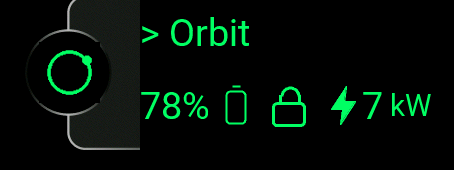
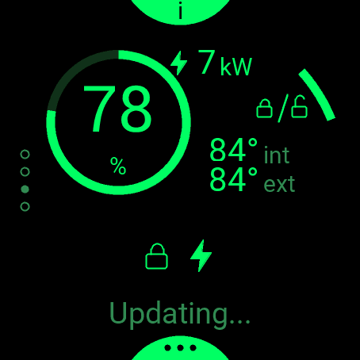
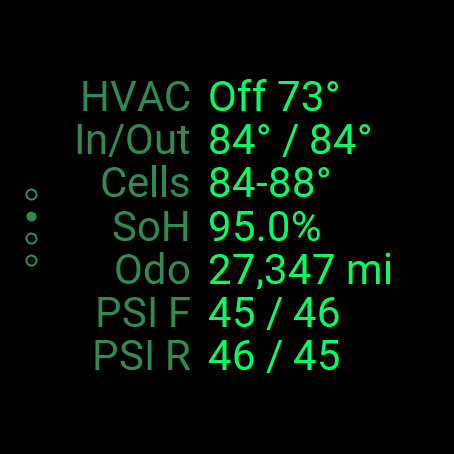
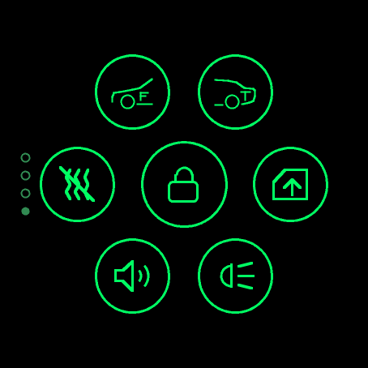
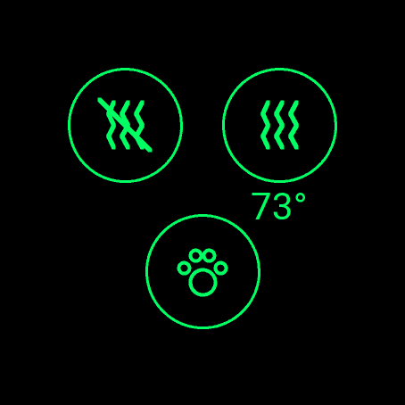
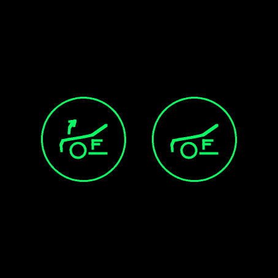
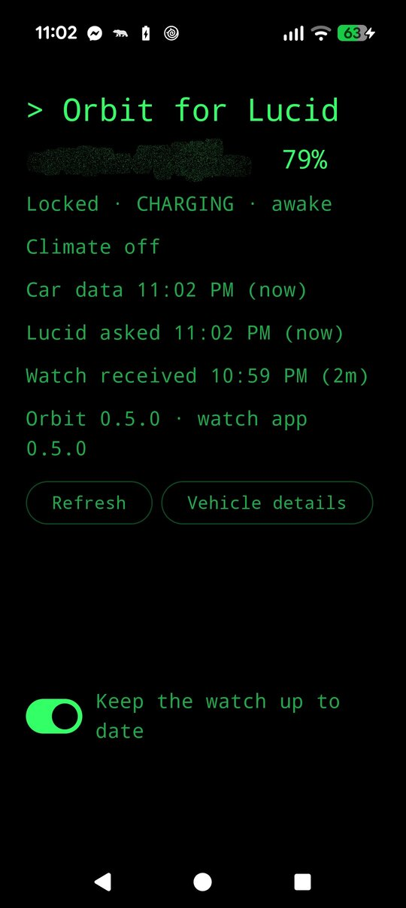
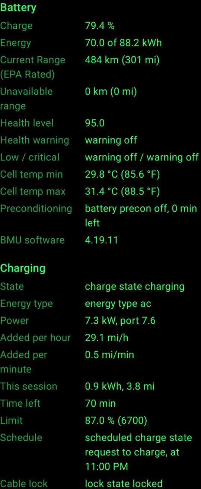

# Orbit for Lucid

Control the core functions of a Lucid vehicle (status/SOC, lock, unlock, precondition) from a Garmin watch, through an
Android companion app. **It needs an Android phone: there is no iPhone version.**

> **Unofficial.** Not affiliated with, endorsed by, or sponsored by Lucid Motors or Garmin. It uses an
> undocumented, reverse-engineered API that may change or be withdrawn at any time, and using it may conflict with
> Lucid's terms. Use at your own risk, on your own account.

## Status

Working end to end on the author's setup: a Pixel 10 Pro, a Garmin Venu 3, and one Lucid. From the watch you can see
state of charge, locked/unlocked, plugged/charging and the inside and outside temperature, then lock, unlock, start
or stop climate at a temperature you pick (in the watch's own units), open and close the frunk and trunk, honk the
horn, flash the lights, close all the windows, switch pet mode on or off, and refresh. The main screen also shows
the charging power, an unattended-occupant warning and open-door and tire warnings, and an info page lists battery
and tire details. Unlock, climate, frunk, trunk, horn and close windows ask for a confirm tap; lock, lights and pet
mode do not. Commands wake a sleeping car first. See [PLAN.md](PLAN.md) for the roadmap.

Only one car, phone and watch have been tried. If you run it on another setup, please
[send a test report](https://github.com/doubletwist13/orbit-for-lucid/issues/new?template=test-report.yml), whether it
works or not.

| Watch | Status |
|---|---|
| Venu 3 | Tested on a real watch |
| fenix 7 | Builds; 0.4.0 was checked in Garmin's simulator, 0.5.0's redesign not yet; never on a real watch |
| Venu X1 | Builds; 0.4.0 was checked in Garmin's simulator, 0.5.0's redesign not yet; never on a real watch |

The fenix 7 and Venu X1 are tentative: treat them as untested until someone runs them on hardware.

## Using the watch app

- **Glance.** The charge in percent with a small battery icon, then a closed or open padlock for locked or unlocked
  (an amber padlock with a `?` when the car's lock state is unknown), then a plug icon: a plug with a slash when
  unplugged, a plain plug when plugged in but not charging, and a bolt while charging. The percent and battery icon
  take the main screen's charge colours. It shows what the phone last pushed, with no age.
- **Pages.** The app is a vertical strip of four pages, with the main screen in the middle. Swipe up or down, or use
  the up and down buttons, to move along it; it stops at both ends. Swipe right, or press back, to leave a screen
  opened from a page. Small dots down the left edge show where you are. From the top: the version and update page,
  the car's details, the main screen, and the actions.
- **Main screen** is information only, so a stray tap does nothing. It opens here, and shows:
  - **Charge.** A ring fills clockwise from the top to match the charge, with the number in percent in the middle.
    The ring and number are green from 50%, yellow from 25%, orange from 10% and red below that.
  - **Charging power.** While charging, a bolt and the power in kW sit above the number (`7 kW`). A second bolt
    shows in the icon row.
  - **Temperatures.** `84° int` and `84° ext` are the cabin and outside air, in the watch's units (`--` for one the
    car did not report, nothing at all if it reported neither).
  - **Quick lock.** A padlock and an open padlock at the top right, with an arc along the bezel coloured by the
    lock state. Tapping them, or pressing the top-right button, opens the lock or unlock choice. These are the only
    parts of the screen besides the two slices below that react to a tap.
  - **Icon row.** Red first, then green, then amber, only for what applies: a person with a red `!` (someone may be
    left in the car), the padlock (closed, open, or amber with `?` if unknown), the plug (slashed when unplugged, a
    bolt while charging), wavy lines while climate is on, then amber icons for an open frunk, trunk or door and for a
    tire pressure warning. They shrink to fit.
  - **Slices.** A green slice at the top (`i`) and one at the bottom (`...`) go to the page above or below when
    tapped. The bottom line of the screen shows only what is in progress ("Unlocking...") or an error. The car only
    reports while awake, so after 30 minutes the whole screen dims; that is normal, not an error.
- **Stays current.** The phone reads the car every 30 s while it is awake or charging and every 60 s while it
  sleeps (every 10 s for 2 minutes after the watch asks for anything). It sends the watch a change at most once a
  minute, and a status every 5 minutes even if nothing changed. This happens while the app is closed and whether or
  not the watch is connected at that moment (a send to an absent watch just fails), so the glance and the main
  screen open on recent data. Android can delay the timer while the phone sleeps. A switch in the phone app turns
  it off; turning it back on sends the last status at once, which is a quick way to refresh a watch that was out of
  range or plugged in. If Garmin Connect restarts, the phone reconnects to it by itself after about 30 seconds.
- **Actions** is the last page: big round icons, with the lock in the middle. Around it, clockwise from the top left:
  frunk, trunk, close all windows, lights, horn and climate. Tap an icon (or, on a watch without touch, highlight it
  with select). The icons on this page act on their own, or open a second screen to choose from.
- **Info** (the page above the main screen) lists climate state, cabin and outside temperature, the coolest and
  warmest battery cell, battery health, odometer and the four tire pressures (front and rear pairs, in the watch's
  units).
- **Version and update** (the top page) shows when the car last reported and when the phone last sent status to the
  watch, so you can tell whether the updates are arriving, and the watch app's and the phone app's versions. Tap it
  to ask the car for its state again (a refresh). The phone app shows the same times, plus when it last asked Lucid.
  Its "Vehicle details" screen lists everything the car reports, plus efficiency figures worked out from the odometer
  and battery energy the phone has logged.
- **Lock** shows a closed or open padlock for the last state it saw, and opens a choice of lock or unlock that does
  not depend on that state. Unlock then asks you to confirm. The main screen's quick lock opens the same choice.
- **Toasts.** An action that sends without a confirm (lock, lights, pet mode) or after one shows a short toast
  ("Locking...") so you know the tap was taken. The result comes later, from the car.
- **Frunk** and **trunk** show the front or back of the car (an Air or a Gravity, as the car reports), with an F or a
  T and an arrow over the lid while it is open. They open a choice of open or close, then ask you to confirm. A
  frunk with a gas strut can only be unlatched, so it goes straight to the confirm. Tested on a car with a powered
  frunk; the gas-strut case is untested.
- **Horn** (one short honk) asks for a confirm tap. **Lights** (flash) act at once. Honk, lights and the rest of the
  actions are ignored by the car in gear (see Limitations). Lucid's API gives no way to
  confirm either, so the watch shows "Sending..." and then clears: it means Lucid took the request, not that the car
  acted on it. Watch or listen for the car, and try again if nothing happened.
- **Windows** closes all four windows after a confirm tap. It is the only window action offered.
- **Climate** opens a choice of off, on, or pet mode. On shows the car's current set point and opens a scrolling list
  over the car's range (59-86 F, or 15-30 C, following the watch's unit setting), then asks you to confirm. Picking a
  new temperature while climate is already on changes it. Pet mode (the paw) switches the car's pet mode on or off at
  once, with no confirm, and the paw is filled in while it is on.
- **Back** is the watch's back button.

### Icon legend

The status icons (glance and main screen):

| Icon | Meaning |
|---|---|
|  | Locked |
|  | Unlocked |
|  | The car reports no lock state (amber) |
|  | Plugged in, not charging |
|  | Not plugged in |
|  | Charging (the main screen adds the power in kW) |
|  | State of charge (coloured like the ring) |
|  | Climate is on |
|  | Unattended occupant (red): someone may be inside |
|  | Frunk open (amber) |
|  | Trunk open (amber) |
|  | A door is open (amber) |
|  | The car's tire pressure warning is on (amber) |

The action icons (Actions page and its second screens). The frunk and trunk are drawn here as the Air; a Gravity has
its own drawings.

| Icon | Action |
|---|---|
|  | Lock (the Actions page shows the car's state) |
|  | Unlock |
|  | Close the frunk |
|  | Open the frunk |
|  | Close the trunk |
|  | Open the trunk |
|  | Close all windows |
|  | Flash the lights |
|  | Honk the horn |
|  | Climate on, with a set point |
|  | Climate off |
|  | Pet mode on or off (filled in while it is on) |

**Timings are anecdotes.** On one car, an unlock from a sleeping car took about 13 seconds without car wifi and 9-10
seconds with it (measured before confirmations were checked every 1.5 s), and a later one took about 8 seconds. A
lock on an awake car takes a second or two. That is a few tests against a single vehicle, and Lucid's cloud is known
to vary wildly: expect results that are much faster or much slower, and don't read the differences as meaningful.

## Screenshots

<p>
  
  
  
  
  
  
  
  
</p>
<p>
  
  
</p>

Top: the watch app on a Venu 3 (glance, main screen, info, actions, lock or unlock, climate). Bottom: the
phone app, which shows status, settings and the car's details (part of that screen is shown); the car is controlled
from the watch. The car's nickname is blurred out in the phone screenshot.

## Limitations

- **One vehicle only.** The author owns a single Lucid (a US vehicle) and has not tried an account with more than one.
  The app uses the first vehicle the account returns and has no way to pick another. Multi-vehicle accounts are
  untested and probably don't work properly; reports and patches are welcome. An account with no vehicle shows
  "No car found" on the watch.
- **The car ignores some commands in gear or while moving.** Many actions, close all windows among them, are sent and
  accepted by Lucid, but the car does nothing if it is in drive or reverse, or moving. The watch's "sent" toast only
  means the request went out, not that the car did it. Park the car first; a close that is not confirmed shows
  "Not confirmed" after about 105 seconds.
- **Lucid's terms.** Orbit has you type your Lucid credentials into software that isn't Lucid's. Section 3 of Lucid's
  Connectivity Services Terms and Conditions tells you not to do anything that might jeopardize the security of your
  password or account, and section 12.3 lets Lucid suspend or cancel accounts at its discretion. Lucid's other terms
  (app and website) may say more; the author has not read them. Whether this is allowed is your call, and any
  consequences for your account are yours.
- **Tested on the Venu 3 only.** The Venu 3 is the only watch it has run on. The manifest also lists the Venu X1
  and the fenix 7 (see the table under Status). Both build without errors. Their 0.4.0 screens (main, actions, info,
  climate, the set point list and the confirm) were run in Garmin's simulator; the redesigned screens of 0.5.0 (the
  main screen's bezel marks, the page strip, the seven-icon Actions page) have not been, and neither has run on a
  real watch. The
  simulator draws Garmin's stock menus differently from real hardware, and memory use and the glance on those
  watches are untested. The Venu X1 needs a Connect IQ SDK with API level 6.0.3 or newer. To try another watch, add its
  id to `manifest.xml` and build with `-d <id>`; if you do, please report what happens. The glance shows cached state
  only (no widget).
- **Tested on one phone.** Android only, tested on a Pixel 10 Pro. Needs Garmin Connect Mobile installed and paired
  with the watch.
- **Not in any app store.** You build both apps yourself and sideload them. See Building.
- **Limited commands.** No charge control, other window actions (vent, open), seat or steering wheel heat, defrost or
  location. Some of that is on the roadmap; some, like seat heat, is left to the car and Lucid's own app on purpose.
- **Temperature units follow the watch.** The Fahrenheit list is the one that has been tried; the Celsius one
  (half-degree steps) has not. The car reads a set point back within about 0.4 F of what was sent, so the number it
  shows can differ from your pick by a rounding step.
- **A notification stays on the phone.** Android only lets the app answer the watch while the phone app is kept
  alive, so it runs a small foreground service with a permanent low-priority notification ("Watch link active").
  On Android 13 and later the app asks for notification permission on first launch, only for this notification.
  If you decline, the notification is hidden but the watch link still works; it just gives you no sign that the
  service is running, and Android may be quicker to stop it. There is no on/off switch: log out in the app to stop
  the watch controlling the car, or stop the app from Android's active-apps list to end the service. The service
  restarts itself after a reboot, once you first unlock the phone. If you force-stop the app, Android won't start it
  again until you open it by hand, and until then the watch says "No phone link".
- **Slow and sometimes laggy.** The car takes a while to wake and to report changes. The app polls for confirmation
  for about 105 seconds, then gives up with "no confirmation yet" (the command may still have worked).
- **Rate limits.** Lucid's gateway throttles its vehicle-list call to about 5 a minute. Orbit reads the car's state
  with a different call that has shown no limit, and backs off if it is ever throttled, but you may still see a "rate"
  error if you hammer it.
- **Lucid sees a status request every 30-60 s.** Besides your taps, the phone asks Lucid for status on that timer
  (every 10 s for 2 minutes after you use the watch; see "Stays current"), from your account, whether or not you are
  using the app. That is the kind of thing Lucid's terms (above) may not welcome; you can turn it off with the switch
  in the phone app. It does not wake the car.
- **Little testing of failure cases.** Offline, logged-out, a car on wifi, battery impact over days (including the
  background updates), and surviving reboots are not well tested yet.
- **The API is unofficial.** It can change or disappear without notice.

## How it works

```
Garmin watch app (Connect IQ, Monkey C)
   | Bluetooth via Garmin Connect Mobile
   v
Android companion app (Kotlin)  -- holds your Lucid session, encrypted on the phone
   | HTTPS
   v
Lucid cloud API (unofficial)
```

Your Lucid credentials never go anywhere except Lucid. There is no Orbit server.

## Layout

| Path | Contents |
|---|---|
| `android/` | Kotlin companion app (Lucid protos from python-lucidmotors, MIT, in `app/src/main/proto`) |
| `watch/` | Monkey C Connect IQ app |
| `docs/` | Protocol, security and research notes |

## Building and installing

Step-by-step instructions for building both apps and sideloading them (including other watch models) are in
[INSTALL.md](INSTALL.md). In short:

- **Garmin SDK:** the Connect IQ SDK is not included in this repo and must not be committed. Install it yourself with
  Garmin's SDK Manager and accept Garmin's license: https://developer.garmin.com/connect-iq/sdk/
- **Android:** the Connect IQ Mobile SDK is pulled from Maven Central by Gradle.
- Install the secret-scanning hook: `git config core.hooksPath .githooks` (requires
  [gitleaks](https://github.com/gitleaks/gitleaks)).
- **Update both apps together.** The watch and phone apps share a message format, and a new watch app can send a
  command an older phone app does not know (the watch then shows "Update phone"). When you update one, update the
  other to the same version; both show theirs (the version and update page on the watch, the main screen of the phone
  app).

## Privacy

Orbit has no server, no accounts and no analytics. The author receives nothing from your use of it.

- **Lucid password:** typed once in the phone app and sent only to Lucid's login service. It is not stored.
- **Lucid session:** only a refresh token is kept, encrypted with a key held in the phone's Android Keystore. Android
  backup is disabled, so it is not copied to the cloud or to a new phone. Log out in the app to delete it.
- **Watch:** stores a cached copy of the last state: charge and charging power, lock state, climate and its set
  point, the inside and outside air temperature, open doors, frunk and trunk, warnings (tires, an unattended
  occupant), pet mode, battery health and cell temperatures, tire pressures, **the odometer**, when the car last
  reported, and the phone app's version. No credentials or tokens are ever sent to the watch, and neither the VIN
  nor the car's location is.
- **Energy log (phone):** to work out efficiency, the phone keeps a plain text log of timestamped odometer and battery
  energy readings in the app's private storage (at most 20,000 lines; the oldest quarter is dropped when it fills).
  It never leaves the phone, Android backup is off, and clearing the app's data or uninstalling it deletes it.
- **Watch to phone:** messages travel over Bluetooth through Garmin Connect Mobile, which is covered by Garmin's own
  privacy terms.
- **Car data:** the phone asks Lucid's cloud for your vehicle's state and sends commands to it. That traffic is between
  your phone and Lucid and is covered by Lucid's terms. Orbit does not log tokens, emails or VINs, and it does not
  request or use your phone's location or the car's. Every 30-60 s the phone also asks Lucid for status unasked,
  whether or not your watch is connected, and sends changes to the watch; a switch in the app turns that off.

## Security

See [SECURITY.md](SECURITY.md). Never commit credentials, tokens, VINs, signing keys or Garmin developer keys.

## A note from the author

I've been in IT a long time and I know my way around security concepts and keeping secrets secret. But my background
is system tool scripting (bash, a bit of Python) and automation (Ansible). I am not a programmer. This app was vibe
coded like a MoFo. I can follow a fair bit of it and I've tested it on my own car, but I couldn't tell you whether the
Kotlin or Monkey C is any good.

I took care with the stuff I do know (no secrets in the repo, no Orbit server, the watch never sees your credentials,
a secret-scanning hook), but that isn't the same as a real code review. If you use this, you're trusting AI-written
code with your car and your Lucid account. You're on your own until a real Android or Garmin developer looks it over
for mistakes. If that's you, please do, and tell me what I got wrong.

## License

MIT, see [LICENSE](LICENSE). Third-party attributions are in [NOTICE](NOTICE). The Garmin SDK is under Garmin's own
license and is not covered by this one.
